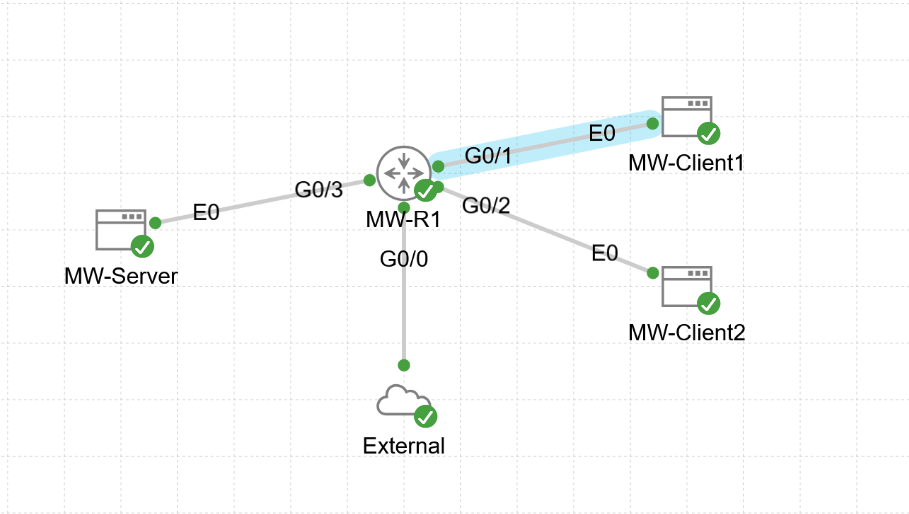
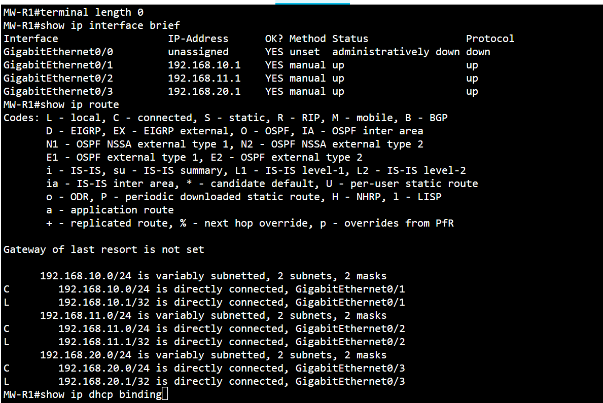
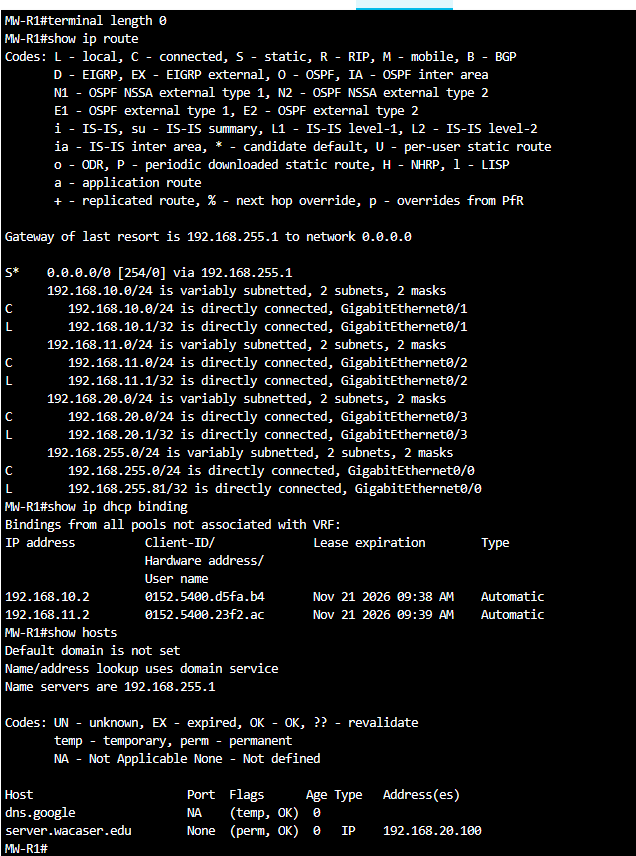
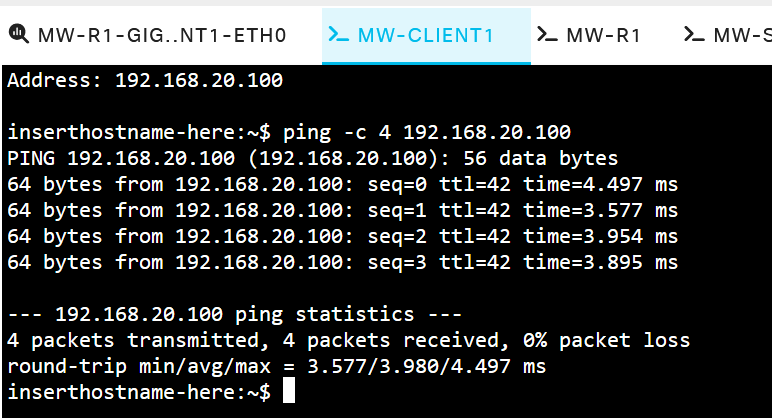
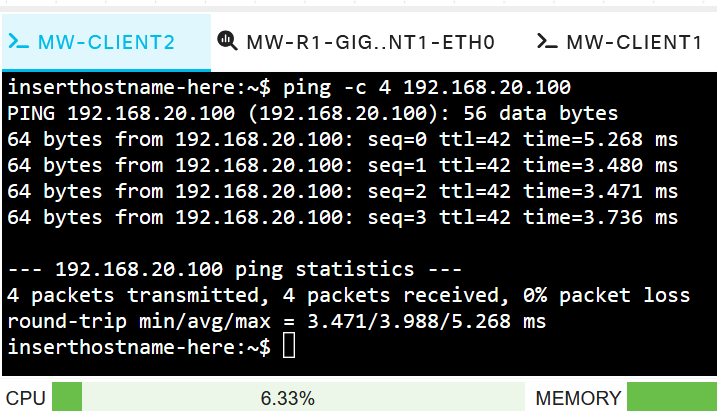
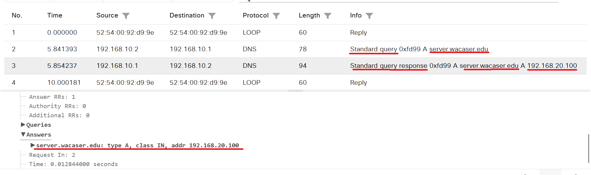
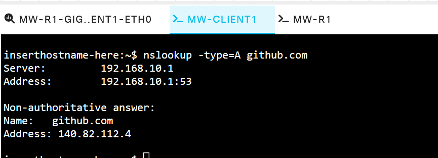

# CommandFleet: Sprint 4 Network Verification Report

**Student:** Madison Wacaser  
**Course:** CS 457 – Computer Networks  
**Date:** November 20, 2026  
**Scope:** CML network infrastructure and DNS verification.

## Overview and topology

I built a CML network with one IOSv router, two Alpine clients, an Alpine game server, and an External Connector in NAT mode. R1 connects three internal subnets and provides the clients' DHCP and DNS services. The server uses a static address. All three internal networks connect directly to R1, so no static routes between routers are needed.



*Figure 1. MW-R1 connects MW-Client1 through Gi0/1, MW-Client2 through Gi0/2, and MW-Server through Gi0/3. Gi0/0 connects to the External Connector.*

| Endpoint | Address | Default gateway | DNS server |
| --- | --- | --- | --- |
| MW-Client1, eth0 | 192.168.10.2/24, DHCP | 192.168.10.1 | 192.168.10.1 |
| MW-Client2, eth0 | 192.168.11.2/24, DHCP | 192.168.11.1 | 192.168.11.1 |
| MW-Server, eth0 | 192.168.20.100/24, static | 192.168.20.1 | 192.168.20.1 |

The client and server addresses and routes were checked using `ip addr show eth0` and `ip route`. The clients' resolver files were checked with `cat /etc/resolv.conf`. Both clients received their address, gateway, and DNS settings through DHCP.

## Internal interfaces, routing, and DHCP



*Figure 2. Gi0/1, Gi0/2, and Gi0/3 are up/up with addresses 192.168.10.1, 192.168.11.1, and 192.168.20.1. The routing table contains the three corresponding connected (C) routes and local (L) host routes. This screenshot was taken before external access was configured: Gi0/0 is still administratively down and no default route is shown.*

R1 uses separate DHCP pools for 192.168.10.0/24 and 192.168.11.0/24. Each pool supplies its own subnet's .1 gateway and DNS address. The .1 addresses are excluded from allocation. The observed client leases were 192.168.10.2 and 192.168.11.2.

After configuring external access, I checked the interfaces again. The recorded console output showed:

```text
Interface                  IP-Address      OK? Method Status                Protocol
GigabitEthernet0/0         192.168.255.81  YES DHCP   up                    up
GigabitEthernet0/1         192.168.10.1    YES manual up                    up
GigabitEthernet0/2         192.168.11.1    YES manual up                    up
GigabitEthernet0/3         192.168.20.1    YES manual up                    up
NVI0                       192.168.10.1    YES unset  up                    up
```



*Figure 3. The current routing table includes all three internal connected routes and the external 192.168.255.0/24 network. Its default route points to 192.168.255.1. The DHCP binding table lists automatic leases for 192.168.10.2 and 192.168.11.2, and the host table contains server.wacaser.edu mapped to 192.168.20.100.*

## Inter-subnet connectivity

I ran `ping -c 4 192.168.20.100` from each client and observed 0% packet loss in both tests. The successful replies showed that traffic could reach the server from both client subnets and return through the server's default gateway, 192.168.20.1.

| Source | Destination | Sent / received | Packet loss | Average RTT |
| --- | --- | --- | --- | --- |
| MW-Client1 | 192.168.20.100 | 4 / 4 | 0% | 3.980 ms |
| MW-Client2 | 192.168.20.100 | 4 / 4 | 0% | 3.988 ms |



*Figure 4. MW-Client1 receives four replies from the server, confirming communication between Subnets A and C.*



*Figure 5. MW-Client2 receives four replies from the server, confirming communication between Subnets B and C.*

## DNS resolution and packet capture

R1's local host table maps `server.wacaser.edu` to `192.168.20.100`. Client 1 tested the record with:

```text
nslookup -type=A server.wacaser.edu 192.168.10.1
```

The recorded console output was:

```text
Server:         192.168.10.1
Address:        192.168.10.1:53

Non-authoritative answer:
Name:   server.wacaser.edu
Address: 192.168.20.100
```

I explicitly requested an A record to test IPv4 resolution without an additional unanswered AAAA query. The capture on the Client 1–R1 link independently confirms the successful exchange.



*Figure 6. The underlined query requests the A record for server.wacaser.edu. The underlined response and expanded Answers section show the returned IPv4 address, 192.168.20.100.*

| Field | Query: frame 2 | Response: frame 3 |
| --- | --- | --- |
| Source | 192.168.10.2:32984 | 192.168.10.1:53 |
| Destination | 192.168.10.1:53 | 192.168.10.2:32984 |
| Transport | UDP | UDP |
| DNS transaction ID | 0xfd99 | 0xfd99 |
| Requested record | server.wacaser.edu, A | server.wacaser.edu, A |
| Answer | None in request | 192.168.20.100 |

The matching transaction ID associates the response with the query. The response code is NOERROR and the response arrives 12.844 ms after the query. The response's authoritative-answer flag is not set, consistent with the console's “Non-authoritative answer” label; the requested local mapping was nevertheless returned successfully.

The original capture contains four frames: the DNS query and response, plus two LOOP frames. It is included without filtering or modification as [sprint_4_dns_lookup.pcap](sprint_4_dns_lookup.pcap).

## External access and DNS troubleshooting

Gi0/0 was configured to obtain an address through DHCP and marked NAT outside. The three internal interfaces were marked NAT inside. NAT overload translates outbound traffic from all three internal subnets to Gi0/0's address. A console check showed this translation for Client 1's DNS request:

```text
Pro Inside global       Inside local        Outside local       Outside global
udp 192.168.255.81:60572 192.168.10.2:60572   192.168.255.1:53    192.168.255.1:53
```

Initially, pings to 8.8.8.8 succeeded with 0% loss, but DNS requests to that address timed out. A direct lookup through 192.168.255.1 succeeded. I changed R1's upstream DNS setting from 8.8.8.8 to 192.168.255.1 and verified external resolution through R1. The clients continued using their local R1 interface as DNS, allowing R1 to answer the game-server name locally and forward external names upstream. The cause of the 8.8.8.8 DNS timeout was not established.



*Figure 7. Client 1 uses its configured resolver, 192.168.10.1, to resolve github.com. This screenshot returned 140.82.112.4; the public answer may differ between lookups.*

## Export and reproducibility

The final [sprint_4_topology.yaml](sprint_4_topology.yaml) contains five nodes, four links, and R1's extracted configuration in an ios_config.txt entry. The extracted settings include the three internal interface addresses, external DHCP addressing, both client DHCP pools, the game-server DNS record, upstream resolver, and NAT overload configuration. This is the configured export, replacing the earlier topology-only file. The export has been inspected; a fresh import has not been tested.

The Alpine nodes have empty startup configuration entries in the YAML. Their temporary Linux IP commands are not recreated by the export. On a fresh deployment, request DHCP on both clients:

```bash
sudo ip link set eth0 up
sudo udhcpc -i eth0
```

On a fresh game-server node, restore its static address, route, and resolver:

```bash
sudo ip link set eth0 up
sudo ip addr add 192.168.20.100/24 dev eth0
sudo ip route replace default via 192.168.20.1
echo "nameserver 192.168.20.1" | sudo tee /etc/resolv.conf
```

These are restoration instructions for fresh nodes, not additional test results. Running `sync` flushes pending disk writes but does not make temporary Linux network commands persistent.

## Conclusion

Both DHCP clients reached the static game server with 0% packet loss. R1's connected routes supported communication across the three internal subnets, and its DNS service resolved server.wacaser.edu to 192.168.20.100. The DNS query and response were verified in the original capture and annotated screenshot. External DNS lookups also succeeded after changing the upstream resolver to 192.168.255.1. The submission includes the configured topology export, DNS capture, and this report with supporting evidence.
